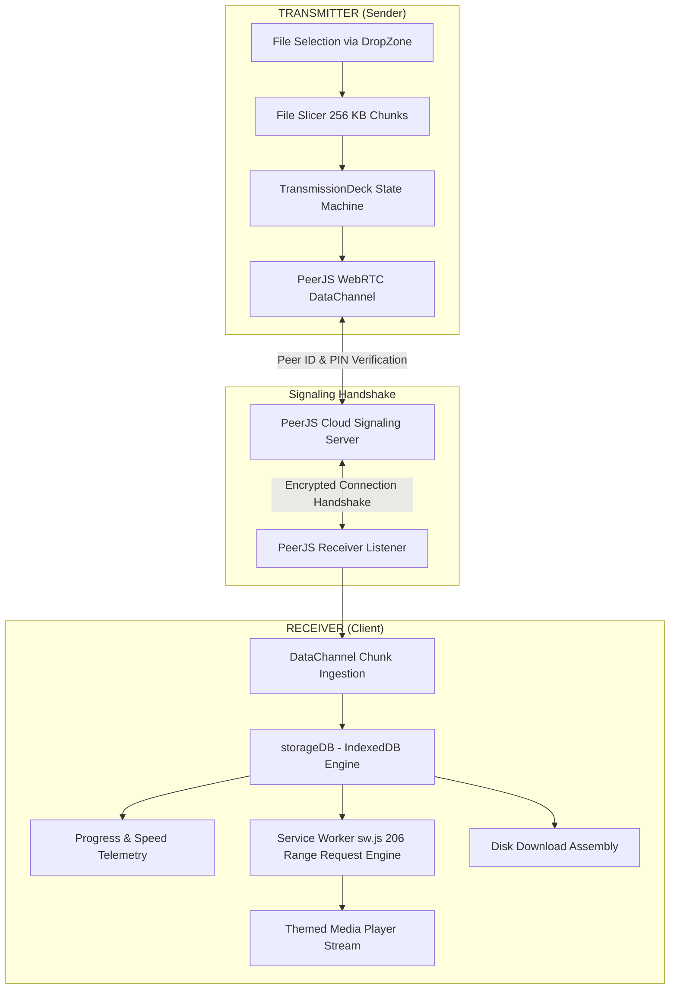

# BEACON // SHARE

> **Peer-to-Peer Browser File Transmission & Ephemeral Media Streaming System**  
> Built with React 19, Vite, WebRTC (PeerJS), and an Industrial Cyber-Minimalist aesthetic inspired by Nothing OS.

---

## 🎯 Overview

**Beacon Share** is a secure, serverless peer-to-peer (P2P) file transfer and ephemeral media playback platform. It establishes direct browser-to-browser WebRTC DataChannels using PeerJS, transferring data without intermediary cloud storage or bandwidth limits.

Designed around a hardware-inspired cyber-minimalist design system, Beacon Share combines retro-futuristic dot-matrix typography, mechanical controls, blinking LED status telemetry, and responsive streaming directly from local browser memory.

---

## ⚡ Key Features

- **Direct WebRTC P2P Transmission**: Zero server file storage. Files are transferred directly between peers in 256 KB binary slices via WebRTC DataChannels.
- **4-Digit Hardware PIN Security**: Senders can enforce a one-time 4-digit PIN with rate-limiting and brute-force lockout safeguards.
- **Themed Media Player**: Embedded audio and visual player styled after retro-mechanical hardware decks:
  - **Audio Deck**: Dynamic audio frequency waveform visualizer, tactile rotary volume dial, progress scrub bar, and duration telemetry.
  - **Image Viewer**: High-resolution image canvas with zoom controls, pan, 90° clockwise rotation, and HUD readouts.
- **Ephemeral Service Worker Streaming (`public/sw.js`)**: Intercepts media requests and serves sequential HTTP `206 Partial Content` byte-range streams directly out of IndexedDB, enabling smooth playback of large media files before transfers finish.
- **IndexedDB Resilience Engine (`src/utils/storageDB.js`)**: Client-side storage engine managing transmission sessions, chunk reassembly, and transfer recovery across browser refreshes.
- **Transmission Deck & Telemetry**: Live throughput calculation (`MB/s`), dynamic ETA estimates, per-file pause/resume/cancel states, and connection status indicators.
- **Multi-File DropZone**: Drag-and-drop file ingestion supporting bulk files, type categorization, byte formatting, and developer testing modes (`?dev=true`).
- **Tactile Rotary Theme Dial**: Physical 180° rotary dial with counter-rotating sun/moon icons, mechanical 12/3/6/9 o'clock index marks, and active glow LEDs for light and dark modes.

---

## 🎨 Design System: Industrial Cyber-Minimalism

Beacon Share adheres strictly to the Nothing OS retro-futuristic hardware design framework (see [`.agents/THEME_SPECIFICATION.md`](.agents/THEME_SPECIFICATION.md)):

- **Typography Pairing**: High-contrast geometric sans-serif (**Manrope**) for copy and titles paired with uppercase dot-matrix monospace (**DotGothic16**) for hardware telemetry, dial tags, and status glyphs.
- **Skeuomorphic Hardware Accents**: CSS-rendered 45° flathead screws, pulsating red warning LEDs (`#d11f2f` in light mode, `#ff3344` in dark mode), camera lens assemblies, and animated audio waveforms.
- **Physical Textures**: Subtle 12px radial dot-matrix card surfaces, glassmorphic backdrop filters, and multi-layered glowing neon scrollbars.

---

## 🏗️ Architecture & Data Flow



---

## 🛠️ Tech Stack

| Layer | Technology |
| :--- | :--- |
| **Framework** | [React 19](https://react.dev/) + [React DOM 19](https://react.dev/) |
| **Build & Tooling** | [Vite 8](https://vite.dev/) with [React Compiler](https://react.dev/learn/react-compiler) & `@rolldown/plugin-babel` |
| **P2P Transport** | [PeerJS](https://peerjs.com/) (WebRTC DataChannel protocol) |
| **File Handling** | [React Dropzone](https://react-dropzone.js.org/) + HTML5 File API + Streams |
| **Persistence & Cache** | IndexedDB API (`beacon_share_db`) + Service Worker Cache Engine |
| **Routing** | [React Router v6](https://reactrouter.com/) (Data Router with v7 transition flags) |
| **Styling** | Vanilla CSS with CSS custom variables adhering to the Theme Specification |
| **Linting & Quality** | [Oxlint](https://oxc.rs/) |

---

## 📂 Project Structure

```
Beacon-Share/
├── .agents/
│   ├── AGENTS.md                   # Agent behavioral guidelines
│   └── THEME_SPECIFICATION.md      # Nothing OS design tokens, CSS variables & hardware specs
├── public/
│   ├── favicon.png                 # Browser favicon
│   ├── nothing_logo.svg            # Mechanical lens logo asset
│   ├── sw.js                       # Ephemeral P2P Service Worker for 206 range streaming
│   └── _redirects                  # SPA client-side routing fallback for Netlify
├── src/
│   ├── assets/                     # Static icons & brand assets
│   ├── components/
│   │   ├── common/
│   │   │   ├── DropZone.jsx        # Drag-and-drop file ingestion zone
│   │   │   ├── DropZone.css        # DropZone hardware styling & dot grid
│   │   │   ├── ThemedMediaPlayer.jsx # Audio frequency player & image viewport
│   │   │   ├── ThemedMediaPlayer.css # Mechanical media deck styles
│   │   │   ├── TransmissionDeck.jsx # Live transfer telemetry & queue controls
│   │   │   └── TransmissionDeck.css # Deck panel & progress bar styling
│   │   └── layout/
│   │       ├── Navbar.jsx          # Header with lens brand, waveform & rotary theme dial
│   │       ├── Navbar.css          # Navigation bar layout & hardware accents
│   │       ├── Footer.jsx          # System status footer
│   │       └── Footer.css          # Footer layout styles
│   ├── context/
│   │   └── ThemeContext.jsx        # Light/Dark mode state management
│   ├── hooks/
│   │   └── useDropZoneService.js   # File ingestion & drag state handler
│   ├── pages/
│   │   ├── Home/                   # Main transmission & receiver landing page
│   │   ├── Receiver/               # Dedicated peer connection, stream & download hub
│   │   ├── About/                  # About page with architectural details
│   │   ├── Contact/                # Communication channels
│   │   ├── Faq/                    # Frequently Asked Questions
│   │   └── Privacy/                # Zero-knowledge P2P privacy statement
│   ├── routes/
│   │   └── Router.jsx              # Application route tree & layout outlets
│   ├── utils/
│   │   └── storageDB.js            # IndexedDB chunk storage & session manager
│   ├── App.jsx                     # Top-level application shell with ThemeProvider
│   ├── index.css                   # Global theme tokens, typography & glowing scrollbars
│   └── main.jsx                    # Application entry point
├── index.html                      # HTML entry template
├── package.json                    # Project metadata & dependencies
├── vite.config.js                  # Vite configuration with React Compiler preset
└── README.md                       # Project documentation
```

---

## 🚀 Getting Started

### Prerequisites

- **Node.js**: v18.0.0 or higher
- **npm**: v9.0.0 or higher (or compatible package manager)

### Installation

```bash
# Clone the repository
git clone https://github.com/pranavkhare11/Beacon-Share.git
cd Beacon-Share

# Install dependencies
npm install
```

### Development Server

Start the local Vite dev server (network-accessible at `0.0.0.0`):

```bash
npm run dev
```

Visit `http://localhost:5173` in your browser.

> [!TIP]
> **Testing Without Two Devices:**  
> Add `?dev=true` or `?mock=true` to your URL (e.g., `http://localhost:5173/?dev=true`) to automatically populate sample files and test UI components without needing an active peer connection.

### Production Build

```bash
# Compile and bundle assets for production
npm run build

# Preview the production build locally
npm run preview
```

### Code Quality & Linting

```bash
# Run oxlint across the project
npm run lint
```

---

## 🔐 How Transmission Works

1. **Beacon Activation (Transmitter)**:
   - The sender drops files into the transmission deck.
   - The sender clicks **"ACTIVATE BEACON"**, generating a unique Peer ID and an optional 4-digit security PIN.
   - A shareable URL (`/receive/:peerId`) or beacon code is generated.
2. **Handshake & PIN Verification (Receiver)**:
   - The receiver navigates to the shared link or inputs the transmitter's Beacon code.
   - If PIN security is enabled, the receiver enters the 4-digit code. Senders enforce rate-limited validation to prevent brute-force attacks.
3. **Chunked Streaming & Persistence**:
   - Files are sliced into 256 KB binary chunks and sent through WebRTC DataChannels.
   - Inbound chunks are written directly to IndexedDB (`beacon_share_db`), ensuring high performance without memory bloat.
4. **Instant Playback or Download**:
   - Audio files can be played back in real-time with the embedded `ThemedMediaPlayer`.
   - Images can be previewed, zoomed, and rotated immediately upon arrival.
   - Completed files can be saved directly to disk.

---

## 📄 License

This project is licensed under the [MIT License](LICENSE).

---

## 👤 Author

**Pranav Khare**  
- GitHub: [@pranavkhare11](https://github.com/pranavkhare11)
